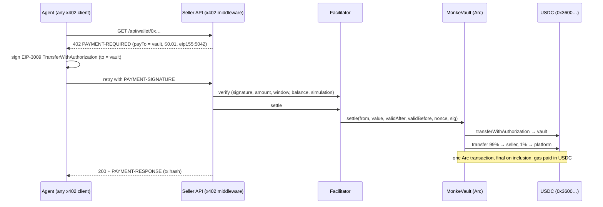

# MonkePay on Arc

**Pay-per-request APIs for AI agents, settled in USDC on Arc mainnet over [x402](https://x402.org), with the seller/platform split enforced on-chain.**

**Live:** https://monkepay-arc-production.up.railway.app · **Contracts:** verified on [Sourcify](https://repo.sourcify.dev/5042/0x33d3d2a4c442f8df1d37bf8de46b1df81d2012e7) · **Chain:** Arc mainnet (`eip155:5042`)

[MonkePay](https://github.com/AliBaig-xD/monkepay-sdk) lets any API charge agents per call in USDC with one line of middleware. It shipped on Base, where the platform fee is collected afterwards by a sweep job. MonkePay on Arc rebuilds the settlement layer for Arc:

| | MonkePay on Base | MonkePay on Arc |
| --- | --- | --- |
| Pay-to address | developer wallet (custodial, provisioned via CDP) | **per-seller `MonkeVault` contract** (non-custodial) |
| Platform fee | collected later by a sweep cron | **split atomically in the settlement tx** |
| Who can redirect funds | backend holds keys | **nobody**: seller, platform and fee are immutable |
| Gas | ETH float on a separate wallet | **USDC**, the same asset being settled |
| Finality | wait for confirmations / reorg risk | **final on inclusion** |
| Facilitator | Coinbase CDP | **self-hosted public facilitator**, Circle-compatible via `sweep()` |

## What's live

- **`MonkeVaultFactory`** [`0x33d3…12e7`](https://explorer.arc.io/address/0x33d3d2a4c442f8df1d37bf8de46b1df81d2012e7): CREATE2 factory, one vault per seller, and the address is known before deployment (`predictVault`).
- **Demo seller vault** [`0x5ff7…9AeC`](https://explorer.arc.io/address/0x5ff73431EBbd2Ad927f0Fa0264270A3368fe9AeC): the x402 `payTo` of the demo API.
- **Paid API:** `GET /api/wallet/:address` returns an Arc wallet snapshot (USDC/EURC balances, activity, recent USDC flows) for **$0.01 per call**.
- **Public x402 facilitator for Arc:** `GET /facilitator/supported`, `POST /facilitator/verify`, `POST /facilitator/settle`.
- **Web app:** live stats, settlement feed, *pay with your own wallet*, and *create your vault* for sellers.
- **Real mainnet settlements:** e.g. [`0x9f0a…60a0`](https://explorer.arc.io/tx/0x9f0a0257023e54e948d87a7ddb60c37ecbe1ba82112e4a9e07b01b8cca2960a0). The dashboard is indexed straight from on-chain `Settled` events.

## How a payment flows



The agent side needs **no MonkePay code**: the demo agent uses the stock `@x402/fetch` client.

## Contracts

`contracts/MonkeVault.sol`, about 120 lines, no dependencies.

- `MonkeVault.settle(from, value, validAfter, validBefore, nonce, signature)` pulls a signed EIP-3009 payment into the vault and splits it in the same call. Anyone can submit it, and the signature commits to `to = vault`, so a relayer cannot redirect or inflate it.
- `MonkeVault.sweep()` splits anything that reached the vault through a plain `transferWithAuthorization`, so vaults work with **any** x402 facilitator, including Circle's.
- `MonkeVaultFactory.createVault(seller)` / `predictVault(seller)` / `vaultOf(seller)` / `isVault(addr)`.
- The fee is fixed per factory (1%) and hard-capped at 10% in the vault constructor.

## Facilitator policy

The public facilitator is open, so it's guarded against griefing its gas wallet:

- Arc mainnet and Arc USDC only.
- `payTo` must be a vault from this factory.
- Minimum payment of $0.001 (below that, gas exceeds the payment).
- It refuses to broadcast when the relayer is low on gas (`503 facilitator_out_of_gas`).
- Per-IP rate limits and a 32 KB body limit.

Verification itself reuses the reference `@x402/evm` exact scheme, which checks the signature, amount, time window, nonce, balance and runs an on-chain simulation.

## Testing

```bash
npm ci
npm run contracts:test   # 8 Foundry tests: split, fuzzed conservation, replay, redirect, inflation, sweep, fee cap
npm run typecheck
npm run e2e              # full paid round trip on Circle's Arc fork (arc-anvil): deploy → serve → pay → assert 99/1 split
```

`.github/workflows/ci.yml` runs the contract tests, server typecheck and web build on GitHub Actions.

## Run it yourself

```bash
cp .env.example .env        # relayer/deployer key with a little USDC on Arc for gas
npm run contracts:build
npx tsx scripts/deploy.ts   # deploys factory + your vault, prints FACTORY_ADDRESS
(cd web && npm ci && npm run build)
npm start                   # API + facilitator + web app on :4021
npx tsx scripts/agent.ts 0xSomeArcAddress http://localhost:4021
```

### Gate your own API with a vault

```ts
import { paymentMiddleware, x402ResourceServer } from '@x402/hono'
import { ExactEvmScheme } from '@x402/evm/exact/server'
import { HTTPFacilitatorClient } from '@x402/core/server'

const facilitator = new HTTPFacilitatorClient({ url: 'https://monkepay-arc-production.up.railway.app/facilitator' })
const server = new x402ResourceServer(facilitator).register('eip155:5042', new ExactEvmScheme())

app.use(paymentMiddleware({
  'GET /v1/data': { accepts: { scheme: 'exact', network: 'eip155:5042', payTo: '<your MonkeVault>', price: '$0.01' } },
}, server))
```

Create your vault from the web app (*Sellers* page) or call `createVault(yourPayoutAddress)` on the factory.

## Why Arc

- **Native USDC with EIP-3009** at `0x3600…0000` (EIP-712 domain `USDC` / `2`), so x402's exact scheme works unchanged.
- **Gas in USDC.** The relayer holds only the asset it settles. A vault settlement is about 129k gas, roughly $0.003 at Arc's 20 gwei floor.
- **Deterministic finality.** The API can serve the response the moment the receipt lands.

## Roadmap

- Batched settlement (x402 `batch-settlement`) so sub-cent prices are economical. Today a $0.01 call costs about $0.003 in gas.
- `network: "arc"` in the MonkePay SDK, so existing MonkePay sellers can switch with one line.
- An MCP tool for agents to discover and pay Arc APIs (building on [WalletLens](https://github.com/AliBaig-xD/walletlens)).
- Durable indexer storage (Postgres) and multi-relayer key rotation.

## Repo layout

```
contracts/      MonkeVault + MonkeVaultFactory (Foundry)
test/           Foundry tests (mock EIP-3009 USDC)
src/            Hono server: x402 paid API, public facilitator, on-chain indexer
scripts/        deploy.ts, agent.ts (stock x402 client), e2e-fork.sh
web/            Next.js frontend (static export, served by the server)
```

ISC licensed. Built by [Ali Baig](https://iamalibaig.com) · [GitHub](https://github.com/AliBaig-xD).
